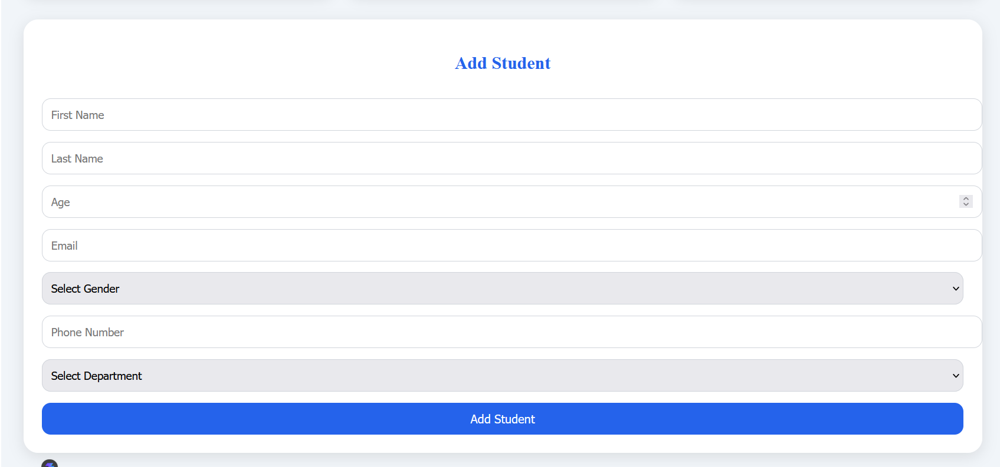
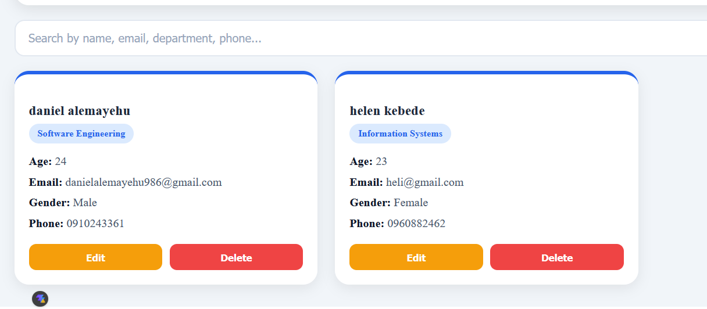
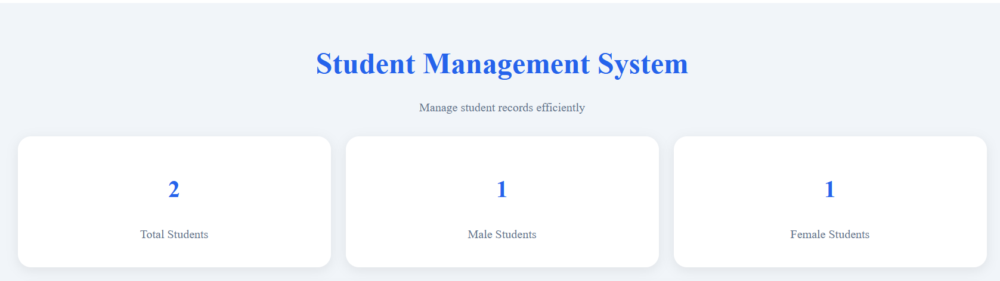

# 🎓 Student Management System

A web-based Student Management System built using **HTML, CSS, and JavaScript** that allows users to manage student records efficiently.
The application supports complete **CRUD operations (Create, Read, Update, Delete)** along with powerful **searching and filtering** functionality.

[Watch Demo Video](https://github.com/chombelm10/student-management-system/assets/record.mp4)
## 🚀 Features

### ➕ Create Student Records
- Add new student information.
- Store details such as ID, Name, Age, Department, Grade, etc.

### 📋 Read/View Records
- Display all student records in a structured table.
- User-friendly interface for viewing data.
### ✏️ Update Records
- Edit and update existing student information.
- Instantly reflect changes in the system.

### ❌ Delete Records
- Remove student records when no longer needed.
- Confirmation before deletion to prevent mistakes.

### 🔍 Search Students
- Search students by name, ID, department, or other attributes.
- Real-time search results.

### 🎯 Filter Students
- Filter records based on specific criteria.
- Quickly find relevant student information.

###for counting number of students

### 📱 Responsive Design
- Works across desktop, tablet, and mobile devices.

---

## 🛠️ Technologies Used

- HTML5
- CSS3
- JavaScript
- React

---

